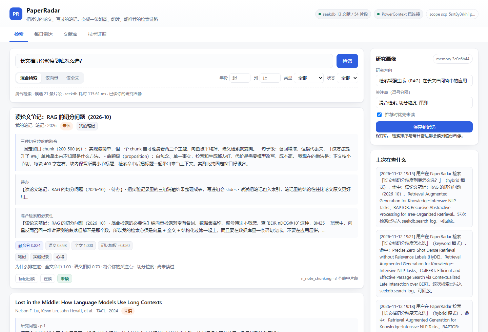
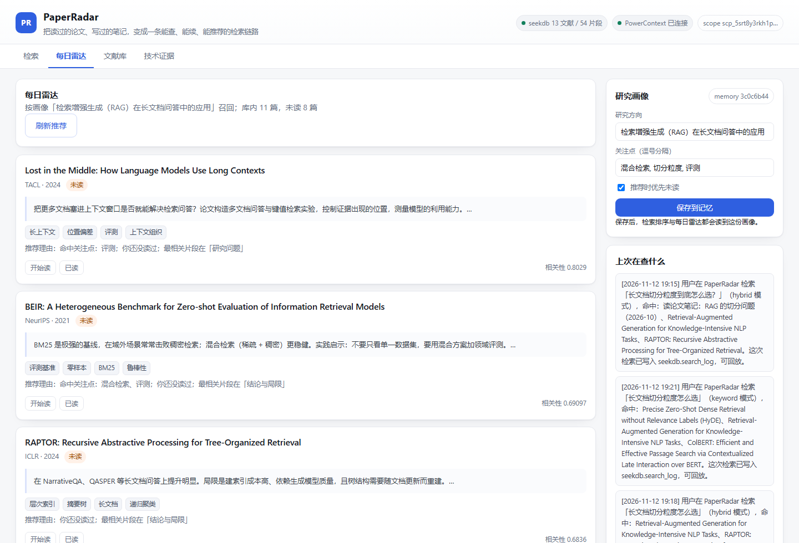
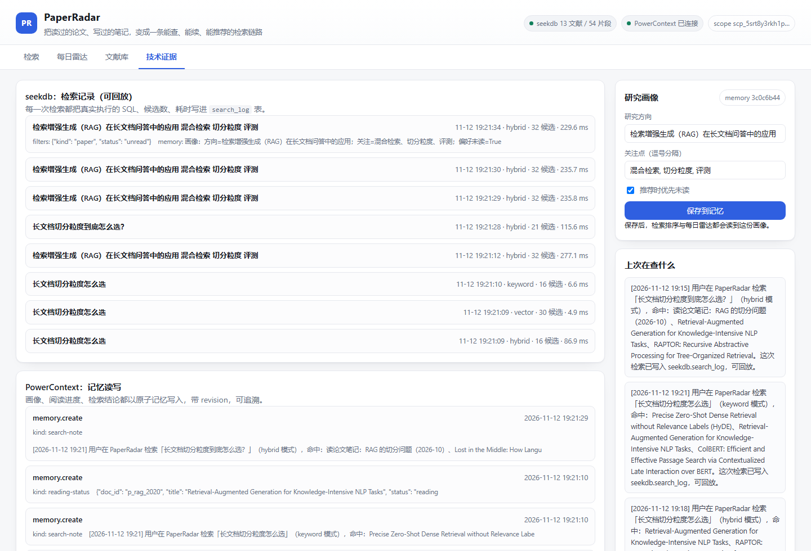

# PaperRadar · 科研文献雷达

> 把读过的论文、写过的笔记，变成一条**能查、能续、能推荐**的检索链路。

PaperRadar 面向科研人员和研究生的一个真实痛点：资料散落在 PDF、笔记和聊天记录里，读完就忘、找不到出处、不知道读到哪里。它把文献与个人笔记统一入库，用 **seekdb** 的一条 SQL 完成「语义 + 关键词 + 结构化条件」的混合检索，并用 **PowerContext** 记住你的研究画像、阅读进度和每次检索的结论，在下一次检索、下一次打开时被复用。

项目为 **Qoder × OceanBase 大赛「Build with Qoder」赛道**作品，主要开发工作在 Qoder 中完成，网站通过 Qoder Sites 发布。

## 它解决什么问题

| 场景 | 以前 | 用 PaperRadar |
| --- | --- | --- |
| 写综述时想起某篇论文讲过某个结论 | 全文搜索靠关键词碰运气，翻 PDF 十几分钟 | 一句话检索，片段级命中 + 出处（论文 / 小节 / 页码） |
| 同义改写找不到（「切分」vs「chunk」） | 关键词检索漏召回 | 混合检索同时走倒排和向量两条路 |
| 复习/续读时不知道上次读到哪 | 靠记忆或翻记录 | 阅读进度存在 PowerContext 记忆里，跨会话可见 |
| 每天决定读什么 | 靠感觉 | 每日雷达按画像召回未读文献，并给出推荐理由 |

## 核心功能

- **混合检索**：`MATCH ... AGAINST` 全文条件、`cosine_distance` 向量近邻、年份/类型/状态过滤，在同一条 SQL 内由 seekdb 完成；应用层做归一化加权融合与解释。支持「混合 / 仅向量 / 仅全文」三种模式对比。
- **片段级出处**：命中返回论文标题、小节、页码和原文片段，答案可追溯。
- **研究画像（PowerContext）**：研究方向、关注点、是否优先未读，存为原子记忆（atomic-memory），检索排序与每日雷达都会读取。
- **阅读进度（PowerContext）**：每篇文献的 未读/在读/已读 以独立记忆维护，带 revision 可追溯；同时同步到 seekdb 镜像列以便 SQL 过滤。
- **检索结论沉淀**：每次检索把「查了什么、命中什么」写入记忆，下次打开在侧栏看到「上次在查什么」，并可通过记忆检索回放。
- **每日雷达**：按画像召回未读文献，说明推荐理由与最相关片段位置。
- **技术证据面板**：所有检索的真实 SQL、候选数、耗时写入 `search_log` 表；所有记忆读写留有 trace，评审可直接核对。

## 界面







## 两个指定技术的分工

| | seekdb | PowerContext |
| --- | --- | --- |
| 角色 | 资料层：文档、片段、向量、全文索引 | 记忆层：研究画像、阅读进度、检索结论 |
| 用法 | 原生 SQL（MySQL 协议），向量列 `VECTOR(384)` + `FULLTEXT ... WITH PARSER ngram` + HNSW 索引 | HTTP API（atomic-memory 读写 / 搜索 / PreparedContext），Scope 隔离 |
| 实际作用 | 检索结果、`search_log` 均可在 seekdb 中核对 | 记忆列表、revision、trace 均可在 Dashboard / API 核对 |

## 快速开始

```bash
# 1. 启动 seekdb（任选其一）
seekdb --port 2881                    # 本地安装版
docker run -d --name seekdb -p 2881:2881 oceanbase/seekdb:latest

# 2. 启动 PowerContext Server（基础模板即可，无需模型 API）
pip install "powercontext[cli,server] @ git+https://github.com/oceanbase/powercontext.git@master"
powercontext config init --template --output .env
powercontext server run --env-file .env      # 默认 http://127.0.0.1:8000

# 3. 安装并初始化本项目
pip install -r requirements.txt
python scripts/bootstrap.py          # 建表 + 示例语料入库

# 4. 启动服务
python -m uvicorn backend.main:app --host 127.0.0.1 --port 8099

# 5. 打开 http://127.0.0.1:8099 并运行端到端自检
python scripts/smoke_test.py
```

详细步骤、各平台差异与常见问题见 [docs/RUNBOOK.md](docs/RUNBOOK.md)；验收用的验证样例见 [docs/VERIFY.md](docs/VERIFY.md)。

## 目录结构

```
backend/
  config.py      配置（环境变量）
  store.py       seekdb 访问层：建表、写入、search_log
  textproc.py    归一化 / 切块 / 查询分词清理
  embedding.py   本地 ONNX 嵌入（all-MiniLM-L6-v2, 384 维）
  search.py      三种检索模式 + 分数融合 + 记忆重排
  memory.py      PowerContext 客户端（atomic-memory 读写与搜索）
  radar.py       每日雷达
  main.py        FastAPI 接口
web/             前端（原生 HTML/CSS/JS，无构建步骤）
data/            示例语料（论文摘要改写 + 个人笔记）
scripts/         bootstrap.py（初始化）、smoke_test.py（自检）
site/            项目网站（Qoder Sites 发布用）
docs/            运行说明、验证样例、开发记录、提交清单
```

## 数据说明

`data/papers.json` 中的论文条目为公开论文（arXiv / 会议）的**摘要与要点改写**，用于演示检索流程，非原文引用；`data/notes/` 为演示用的个人笔记与实验记录。替换成自己的文献只需保持相同 JSON 结构，再执行一次 `python scripts/bootstrap.py`（会重建表并重新入库）。

## License

MIT
